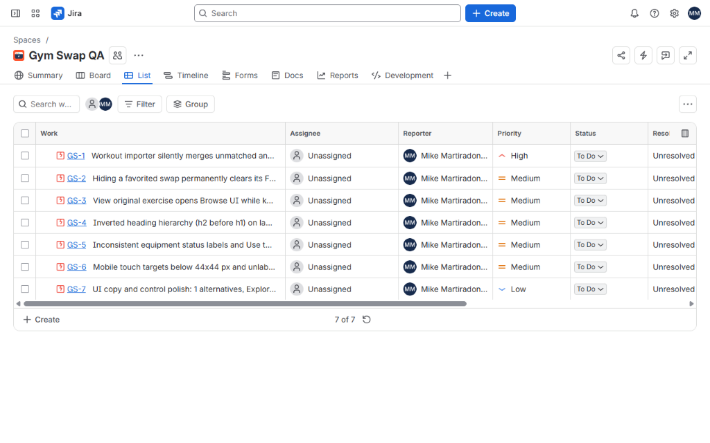

# Gym Swap Manual QA Suite

Manual test plan, desktop and phone execution log, and reproducible bug reports for the live **Gym Swap** web app (`https://gymswap.seeform.ai`, Build `2.8.1`). This manual QA pass complements the 357 automated unit and integration tests in Gym Swap's private 2.8.1 source suite by verifying end-to-end user flows, responsive phone layout, browser storage persistence, and accessibility in a real browser.

## Summary of Findings (Build 2.8.1)

| Metric | Result |
|---|---|
| Target tested | `https://gymswap.seeform.ai` (Build `2.8.1`, 133 exercises, 29 starting exercises, 270 reviewed comparisons) |
| Viewports tested | Desktop (`1280×800`) and Mobile (`390×844`), Chromium |
| Test cases executed | **18** (`TC-01` through `TC-18`) |
| Passed / Failed | **11 Pass** · **7 Fail** (across Desktop and Mobile) |
| Console / network errors | **0** console errors · **0** failed HTTP requests (`4xx`/`5xx`) · **0** mobile horizontal overflow |
| Reproducible bugs logged | **7** (`GS-1`–`GS-7`): **1 High**, **5 Medium**, **1 Low** |

## Jira Issue Tracking (`GS-1`–`GS-7`)

All 7 reproducible defects are tracked as `Bug` issues in Jira Cloud (`Gym Swap QA`, project key `GS`) with priorities, labels, steps to reproduce, and expected vs. actual results.

## Artifacts in This Folder

| File | Purpose |
|---|---|
| [test-plan.md](test-plan.md) | Scope, risk assessment, test environments, severity definitions, and 18 manual test cases |
| [test-execution-log.md](test-execution-log.md) | Pass/Fail outcomes on Desktop (`1280×800`) and Mobile (`390×844`) linked to each bug ID |
| [bug-reports.md](bug-reports.md) | 7 Jira-formatted bug reports with exact steps to reproduce, expected vs. actual results, and triage notes |
| [jira-export.csv](jira-export.csv) | CSV export from Jira Cloud of issues `GS-1` through `GS-7` (account ID columns removed) |
| [jira-list.png](jira-list.png) | Screenshot of the 7 tracked bugs in the Jira `Gym Swap QA` List view |
| [jira-import.csv](jira-import.csv) | Source CSV used to import the 7 issues into Jira Cloud |
| [zendesk/README.md](zendesk/README.md) | Zendesk Support sandbox setup (3 views, 3 macros, 3 triggers, SLA policy, and 9 solved tickets linked to `GS-1`–`GS-7`) |

## Defect Snapshot

| ID | Summary | Severity | Priority | Environment |
|---|---|---|---|---|
| `GS-1` | Workout importer merges unmatched and typo lines into the previous exercise's notes | High | P1 | Desktop & Mobile |
| `GS-2` | Hiding a favorited swap clears its Favorite state permanently after restore | Medium | P2 | Desktop & Mobile |
| `GS-3` | "View original exercise" opens Browse UI while keeping "Replace an exercise" tab active | Medium | P2 | Desktop & Mobile |
| `GS-4` | Inverted heading order (`h2` before `h1`) on landing and empty `h1` after search | Medium | P2 | Desktop & Mobile |
| `GS-5` | Inconsistent equipment status labels and "Use this swap" stays enabled when marked "In use" | Medium | P2 | Desktop & Mobile |
| `GS-6` | Mobile touch targets below 44×44 px and unlabeled equipment filter inputs | Medium | P3 | Mobile (`390×844`) |
| `GS-7` | Minor copy and control polish ("1 alternatives", wrong mode button label, duplicate back control, no Search Clear) | Low | P3 | Desktop & Mobile |
