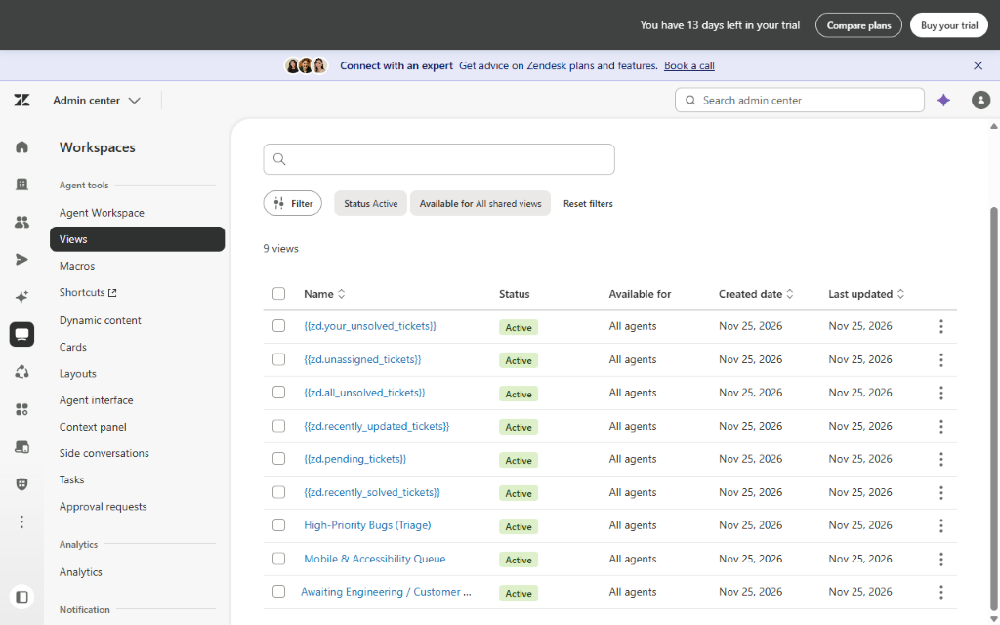
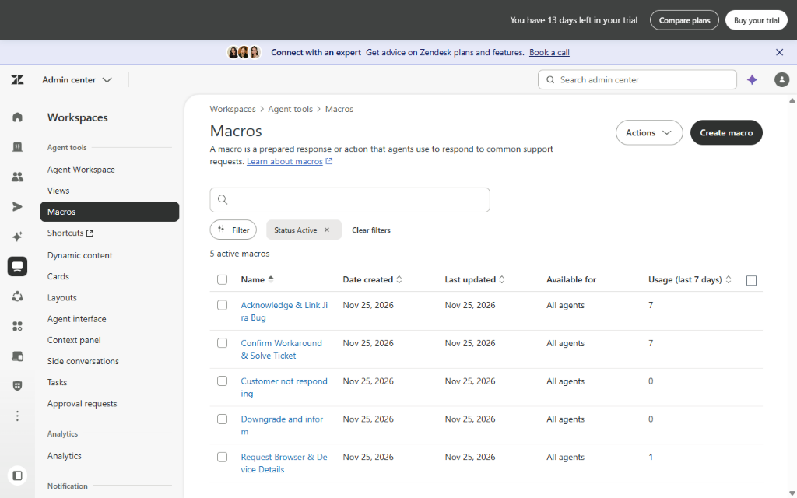
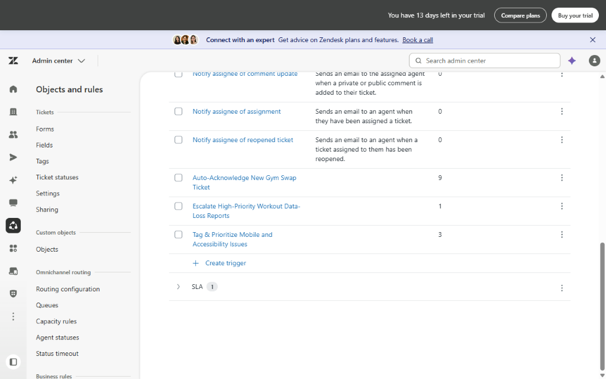
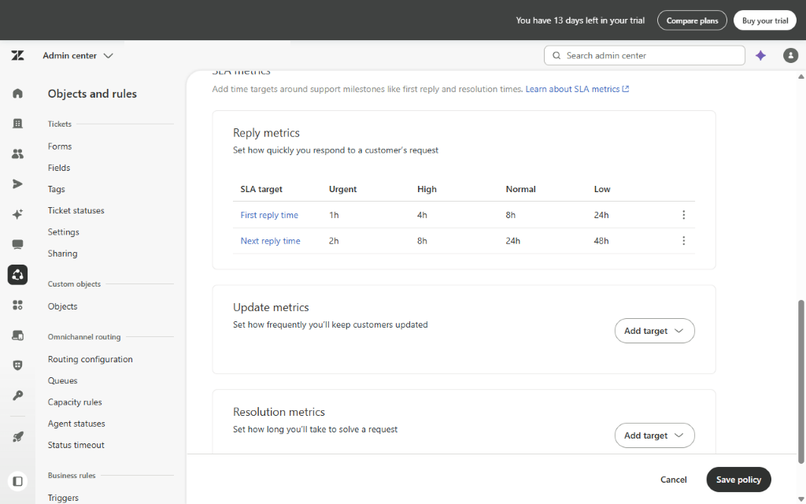
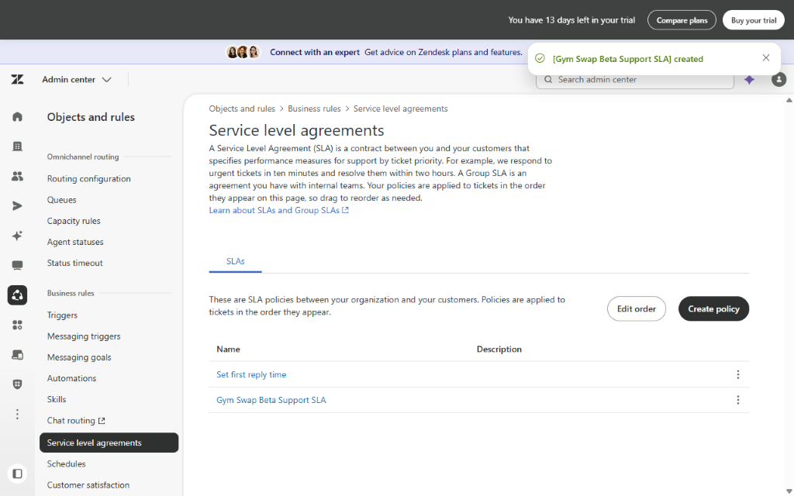
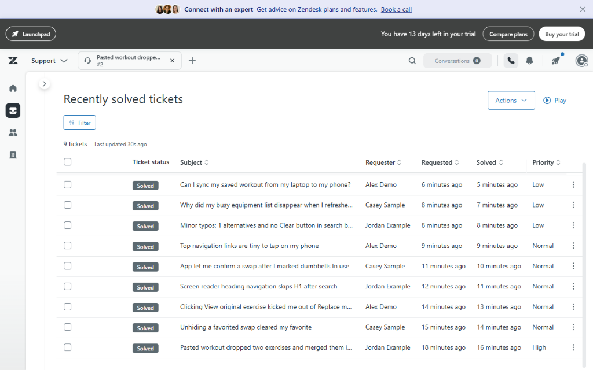
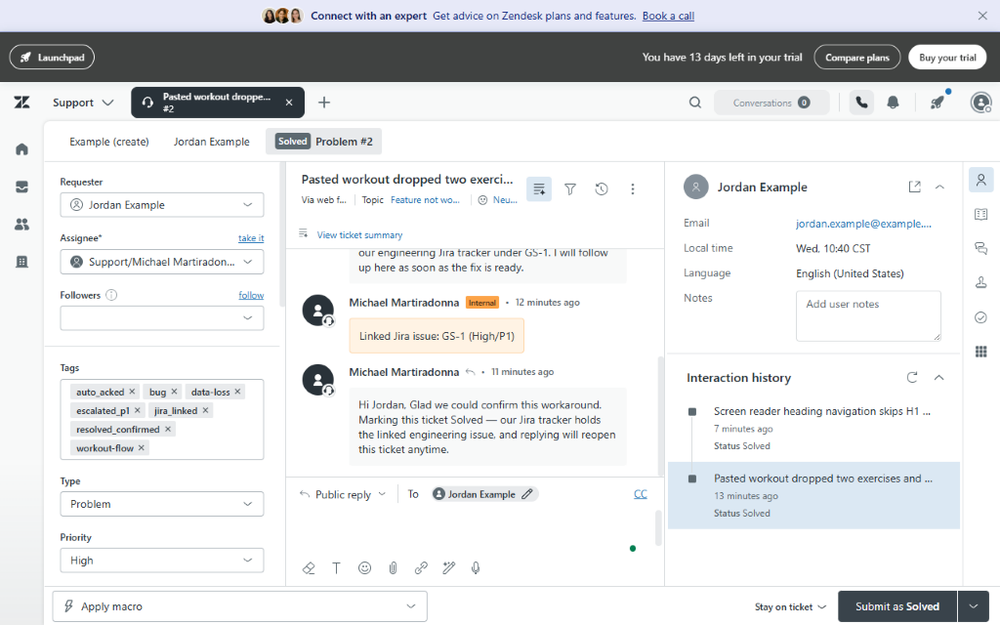

# Gym Swap Beta Support — Zendesk Sandbox Configuration

Help-desk workflow built in **Zendesk Suite** to triage and resolve beta user reports for Gym Swap (`Build 2.8.1`), linking frontline support tickets directly to the 7 reproducible engineering bugs in [Jira (`GS-1`–`GS-7`)](../bug-reports.md). All requesters and ticket payloads use fictional identities (`Jordan Example`, `Casey Sample`, `Alex Demo`).

## Configured Support Components

### 1. Custom Views (3 Active)
- **`High-Priority Bugs (Triage)`** — Open/New/Pending tickets with `Priority > Normal` and tag `bug`, ordered by priority.
- **`Mobile & Accessibility Queue`** — Unsolved tickets tagged `mobile` or `accessibility`.
- **`Awaiting Engineering / Customer Reply`** — Tickets in `Pending` status to surface stalled follow-ups.

### 2. Agent Macros (3 Active, Live Usage Verified)
- **`Acknowledge & Link Jira Bug`** (`7` uses) — Sets status `Open`, tags `jira_linked` and `bug`, and inserts a standardized public reply referencing the linked Jira issue (`GS-1`–`GS-7`).
- **`Request Browser & Device Details`** (`1` use) — Sets status `Pending`, tags `needs_repro`, and requests device, browser, and repro steps.
- **`Confirm Workaround & Solve Ticket`** (`7` uses) — Sets status `Solved`, tags `resolved_confirmed`, and confirms the workaround while keeping the engineering ticket tracked in Jira.

### 3. Event-Driven Triggers (3 Active, Live Firings Verified)
- **`Auto-Acknowledge New Gym Swap Ticket`** (`9` firings) — Fires on ticket creation to tag `auto_acked` without re-triggering.
- **`Escalate High-Priority Workout Data-Loss Reports`** (`1` firing) — Matches `data-loss` tags or keywords (`missing`, `merged`, `swallowed`, `lost`) on creation, escalating Priority to `High`, Type to `Problem`, and adding `escalated_p1` and `bug`.
- **`Tag & Prioritize Mobile and Accessibility Issues`** (`3` firings) — Routes mobile/a11y reports into `ux_a11y_queue` at `Normal` priority.

### 4. SLA Policy (`Gym Swap Beta Support SLA`)
Applies First Reply and Next Reply targets by ticket priority:

| Priority | First Reply Time | Next Reply Time |
|---|---|---|
| **Urgent** | 1 hour | 2 hours |
| **High** | 4 hours | 8 hours |
| **Normal** | 8 hours | 24 hours |
| **Low** | 24 hours | 48 hours |

## Tickets Triaged & Resolved (`9/9 Solved`)

Nine beta tickets (`#2`–`#10`) — covering all 7 Jira bugs (`GS-1`–`GS-7`) plus 2 common user questions (why temporary equipment notes reset on reload, and local browser storage vs. cross-device sync) — were created, triaged through the triggers and macros above, annotated with internal Jira references, and resolved cleanly to **Solved**:

Example escalated **High / Problem** ticket (`#2`, linked to Jira **`GS-1`**) showing automatic trigger tags (`auto_acked`, `escalated_p1`), agent macro replies (`jira_linked`, `resolved_confirmed`), and the internal engineering handoff note (`Linked Jira issue: GS-1 (High/P1)`):

